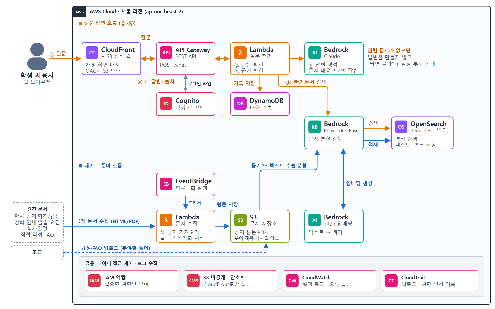

# RAG 챗봇 서비스 기획서 (1주차)

> 클라우드아키텍처 1주차 과제로 제출한 기획서를 Markdown으로 옮긴 것입니다.

## 1. 서비스 개요

학사 길잡이는 학사 공지, 학칙, 장학 안내, 졸업 요건 같은 학교 문서를 바탕으로 학생 질문에 답해 주는 RAG 챗봇이다. 답변할 때 어떤 문서를 참고했는지 출처도 같이 보여 준다.

**대상 사용자**

- **주 사용자: 재학생**
  학사 절차를 처음 겪는 신입생·편입생이나, 휴학했다가 오랜만에 복학하는 학생
- **보조 사용자: 학과 조교·행정 직원**
  챗봇이 참고할 규정과 FAQ 문서를 S3에 올리고 관리하는 사람

**해결하려는 문제**

- 학사 공지, 학칙, 장학 안내가 여러 게시판과 첨부 파일에 흩어져 있어서 필요한 내용을 찾기 어렵다.
- 게시판 검색은 제목에 들어간 단어로만 찾을 수 있어서, 궁금한 걸 문장으로 물어보면 원하는 글이 잘 안 나온다.
- 기준이나 일정이 학기마다 바뀌는데, 커뮤니티나 선배에게 들은 예전 정보를 믿었다가 신청 기간을 놓치는 경우가 있다.
- 학기 초마다 학과 사무실에 비슷한 질문이 반복해서 들어온다.

**사용 후 기대하는 행동**

학생이 챗봇에 물어보고 답과 근거 공지를 바로 확인해서, 신청 기간이나 졸업 요건을 놓치지 않는 것이 목표다. 챗봇이 답하지 못하는 질문은 담당 부서에 문의하도록 안내한다.

## 2. 활용 데이터

성적이나 학적처럼 개인정보가 들어간 데이터는 쓰지 않고, 학교 홈페이지에 공개된 문서와 직접 만든 가상 FAQ만 사용한다. 출처 표시와 분야 선택에 쓰기 위해 문서마다 제목, 분야, 게시일, 원문 링크를 같이 저장한다.

| 데이터 종류 | 주요 내용 | 확보 방법 | 형식 | 사용 가능 여부 |
|---|---|---|---|---|
| 학사 공지 | 수강신청, 휴·복학, 성적, 계절학기 안내 | 학사 공지 게시판에서 수집 | HTML, PDF (HWP는 텍스트로 변환) | 가능 (공개 게시물, 개인정보가 있는 글은 제외) |
| 학칙·학사 규정 | 휴학, 성적, 졸업 관련 규정 | 학교 규정집 PDF를 내려받아 업로드 | PDF | 가능 (공개 자료) |
| 장학금 안내 | 장학금 종류, 신청 자격과 기간 | 장학 공지 게시판에서 수집 | HTML, PDF (HWP는 텍스트로 변환) | 가능 (공개 게시물) |
| 졸업 요건·교육과정 | 전공·교양 이수 학점, 졸업 기준 | 학과 홈페이지 자료 | PDF, HTML | 가능 (공개 자료, 실습에서는 일부 학과 자료만 사용) |
| 학사일정 | 수강신청, 등록, 휴·복학 신청 기간 | 학사일정 페이지에서 수집 | HTML | 가능 (공개 자료) |
| 자주 묻는 질문(FAQ) | 학기 초에 자주 나오는 질문과 답변 | 공개 문서를 참고해서 직접 작성 (실제 운영 시에는 조교가 작성) | 텍스트 | 가능 (직접 만든 가상 자료) |

답변이 잘 나오는지 확인하려고, 문서에 있는 질문과 없는 질문을 섞어 테스트 질문을 20개 정도 만들고 답이 맞는지, 출처가 맞는지 확인한다.

## 3. 주요 기능 동작 명세

### 서비스 핵심 기능

| 기능 | 사용자가 하는 일 | 확인하는 결과 |
|---|---|---|
| 질문 답변 | 궁금한 내용을 문장으로 입력 (예: 휴학은 몇 학기까지 가능한가요?) | 관련 문서를 바탕으로 정리한 답변 |
| 출처 표시 | 답변 아래 출처 확인, 원문 링크 클릭 | 참고한 문서 제목, 게시일, 원문 링크 |
| 답변 불가 안내 | 등록된 문서에 없는 내용을 질문 | 근거 문서를 찾지 못했다는 안내와 담당 부서 안내 |
| 분야 선택 | 학사 / 장학 / 졸업 / 학사일정 중 선택 | 선택한 분야의 문서에서만 찾아서 답변 |
| 문서 올리기 (조교) | 규정·FAQ 파일을 S3 문서 버킷의 분야별 폴더에 업로드 | 다음 동기화 후 챗봇 답변에 반영 |

### 데이터 준비 흐름

**문서 수집 → 텍스트 추출 및 분할 → 임베딩 생성 → 벡터 검색 저장소에 적재**

| 단계 | 처리 내용 | 처리 데이터 | 저장 위치 |
|---|---|---|---|
| ① 문서 수집 | EventBridge가 하루에 한 번 Lambda를 실행해서 학사·장학 게시판의 새 글을 가져오고, 다 가져오면 Knowledge Bases 동기화를 시작한다. 첨부가 HWP면 텍스트만 뽑아서 함께 저장한다. 규정, 졸업 요건, FAQ는 조교가 S3의 분야별 폴더에 올리고, 업로드 이벤트로 실행되는 Lambda가 폴더 이름을 보고 문서 정보를 만든다. | 공지 본문, PDF 파일, 문서 정보(제목, 분야, 게시일, 링크) | S3 문서 버킷 |
| ② 텍스트 추출 및 분할 | S3에 올라온 문서에서 텍스트를 뽑고, 검색하기 좋은 크기로 나눈다. 이 과정은 Bedrock Knowledge Bases에서 처리한다. | 나눈 텍스트 조각과 문서 정보(제목, 분야, 게시일, 링크) | Bedrock Knowledge Bases에서 처리 |
| ③ 임베딩 생성 | Bedrock 임베딩 모델(Titan)로 텍스트 조각을 벡터로 바꾼다. | 벡터 | - |
| ④ 벡터 저장소 적재 | 벡터와 원문 텍스트, 문서 정보를 함께 저장한다. 새 문서가 올라오거나 바뀌면 다시 동기화하고, 지난 학기 공지는 학기가 끝나면 S3에서 지운 뒤 다시 동기화한다. | 벡터, 텍스트, 문서 정보 | OpenSearch Serverless |

### 질문 답변 흐름

**질문 입력 → 관련 문서 검색 → 근거 기반 답변 생성 → 답변 및 출처 표시**

| 단계 | 동작 | 사용 서비스 |
|---|---|---|
| ① 질문 입력 | 로그인한 학생이 채팅 화면에서 질문을 입력하면 API Gateway를 거쳐 Lambda로 전달된다. | CloudFront, Cognito, API Gateway |
| ② 질문 확인 | Lambda가 빈 질문인지 확인하고, 질문에 학번이나 전화번호가 있으면 가린다. | Lambda |
| ③ 관련 문서 검색 | 질문을 벡터로 바꿔서 OpenSearch에서 비슷한 문서 조각을 몇 개 찾는다. 분야를 선택했다면 그 분야 문서에서만 찾는다. 찾은 결과는 Lambda가 게시일 순으로 다시 정렬해서 최근 공지를 먼저 쓴다. | Bedrock Knowledge Bases, OpenSearch Serverless |
| ④ 근거 확인 | 검색 점수가 정해 둔 기준보다 낮으면 관련 문서가 없다고 보고, 답변을 만들지 않고 답변할 수 없다는 안내와 담당 부서를 알려 준다. 기준 점수는 테스트 질문으로 맞춘다. | Lambda |
| ⑤ 답변 생성 | 찾은 문서와 질문을 Claude에 같이 보내고, 문서에 있는 내용으로만 답하도록 한다. | Bedrock (Claude) |
| ⑥ 답변 및 출처 표시 | 답변과 함께 참고한 문서의 출처를 화면에 보여 주고, 질문과 답변 기록을 DynamoDB에 저장한다. | Lambda, DynamoDB, CloudWatch |

**화면에 표시할 출처 정보**

- 문서 제목과 분야
- 게시일
- 원문 링크

## 4. 전체 아키텍처 구성도

그림 1. 학사 길잡이 AWS 아키텍처 (주황 화살표: 질문·답변 흐름, 파란 화살표: 데이터 준비 흐름)

| 구성 요소 | 선택한 서비스 또는 기술 | 역할 및 선정 이유 |
|---|---|---|
| 웹 프론트엔드 | Amazon S3 + CloudFront | 채팅 화면을 S3에 올리고 CloudFront로 배포한다. 서버 없이 정적 웹을 운영할 수 있고, OAC를 써서 S3에는 CloudFront로만 접근하게 한다. 도메인은 Route 53으로 CloudFront에 연결한다. |
| 사용자 인증 | Amazon Cognito | 학생 로그인을 처리한다. 로그인한 사용자만 API를 쓸 수 있게 해서 무분별한 호출을 막는다. |
| 백엔드 API | Amazon API Gateway + AWS Lambda (Python) | 질문 요청을 받아 처리한다. EC2나 ECS로 서버를 계속 켜 두는 것보다, 수강신청 기간처럼 특정 시기에만 요청이 몰리는 서비스라 쓴 만큼만 비용을 내는 Lambda가 맞다고 판단했다. 모든 구성이 관리형 서비스라 별도 VPC는 두지 않았다. |
| 문서 저장소 | Amazon S3 | 수집한 공지와 PDF, 조교가 올린 규정·FAQ를 저장한다. 파일을 용량 걱정 없이 쌓아 둘 수 있고, Knowledge Bases가 이 버킷을 바로 데이터 소스로 쓸 수 있어서 선택했다. |
| 수집 자동화 | Amazon EventBridge Scheduler + Lambda | 하루에 한 번 수집 Lambda를 실행한다. 서버를 따로 켜 두지 않고 정해진 시간에만 실행할 수 있어서 선택했다. |
| RAG 파이프라인 | Amazon Bedrock Knowledge Bases | 문서를 나누고 벡터로 바꿔 저장하는 과정과 검색 기능을 제공해서, 직접 구현할 부분이 줄어든다. |
| 벡터 검색 저장소 | Amazon OpenSearch Serverless (벡터 검색 컬렉션) | 벡터 검색을 지원하고 서버 관리가 필요 없다. 수업의 RAG 챗봇 아키텍처 예시에서도 쓴 저장소다. 다만 사용하지 않아도 최소 요금이 계속 나가므로 실습이 끝나면 컬렉션을 꼭 삭제한다. Knowledge Bases를 지워도 컬렉션은 남기 때문에 따로 지워야 한다. |
| 임베딩 모델 | Amazon Bedrock – Titan 임베딩 모델 | 문서와 질문을 벡터로 바꾼다. 한국어를 지원하고 Bedrock 안에서 바로 쓸 수 있다. |
| 생성 모델 | Amazon Bedrock – Claude | 검색된 문서를 바탕으로 답변을 만든다. 한국어 답변이 자연스럽고, 문서 내용으로만 답하라는 지시를 잘 따른다. |
| 대화 로그 | Amazon DynamoDB | 질문과 답변 기록을 저장한다. 쓴 만큼만 비용이 나가는 서버리스 DB이고, TTL로 한 학기가 지난 기록은 자동으로 지운다. |
| 모니터링·감사 | Amazon CloudWatch, AWS CloudTrail | Lambda 실행 로그와 오류를 확인하고, 누가 어떤 설정을 바꿨는지 기록한다. |

### 데이터 접근 방안

- S3 버킷은 퍼블릭 액세스를 막아 두고, 웹 화면은 CloudFront(OAC)를 통해서만 보이게 한다.
- Lambda에는 필요한 권한만 가진 IAM 역할을 붙인다. 예를 들어 질문 처리 Lambda는 Bedrock 호출과 DynamoDB 저장만, 수집 Lambda는 S3 저장과 Knowledge Bases 동기화 시작만 할 수 있게 한다.
- API Gateway에서 Cognito 로그인 정보를 확인해서 로그인한 학생만 챗봇을 쓸 수 있게 한다. 과제 범위에서는 가입 제한은 따로 두지 않는다.
- S3와 DynamoDB에 저장되는 데이터는 KMS로 암호화하고, 통신은 HTTPS로 한다.
- 공개 문서만 사용하고, 질문에 들어간 학번이나 전화번호는 가린 뒤 저장한다.
- 조교는 문서 버킷에 파일을 올리는 권한만 가진 IAM 사용자로 접근한다.

### 로그 수집 방안

- Lambda 실행 기록과 오류는 CloudWatch Logs에 남긴다.
- 질문과 답변, 참고한 문서는 DynamoDB에 저장해서, 답을 못 한 질문을 확인하고 문서를 보충하는 데 쓴다.
- Bedrock 모델 호출 로깅을 켜서 사용량과 비용을 확인한다.
- 오류가 많아지면 CloudWatch 알람으로 관리자에게 알린다.
- CloudTrail로 권한 변경과 문서 업로드·삭제 기록을 남긴다. (S3 데이터 이벤트 기록은 따로 켬)
